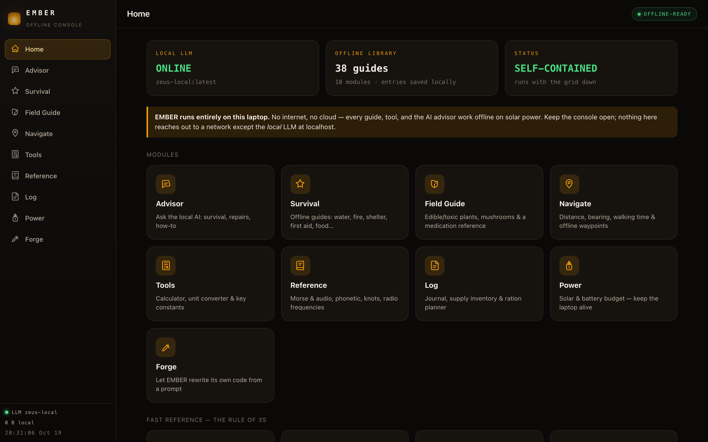
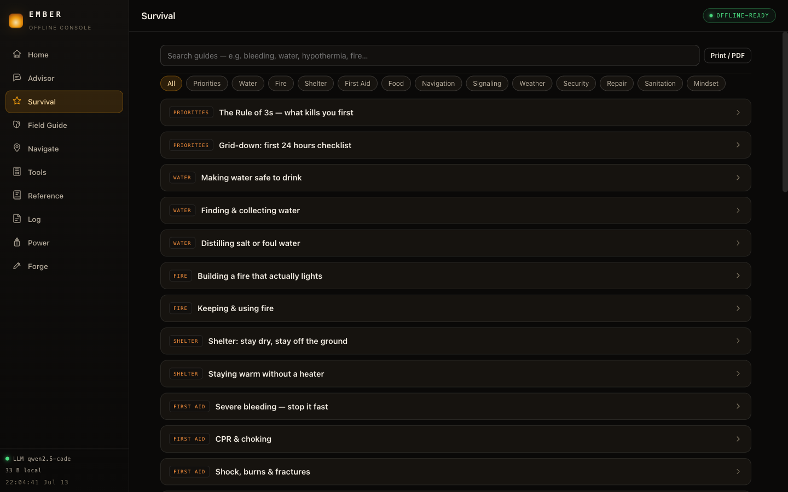
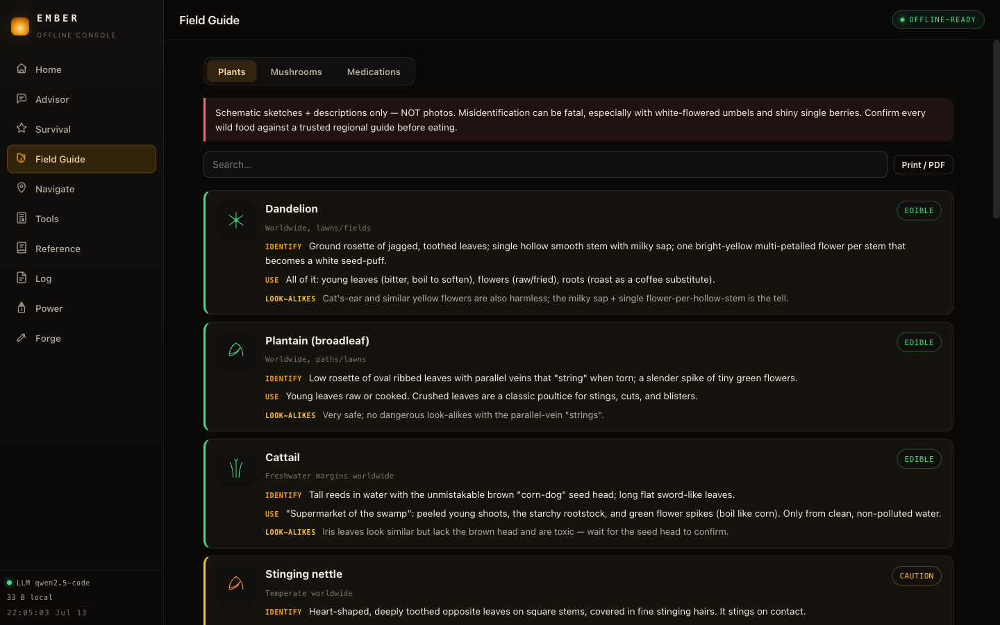
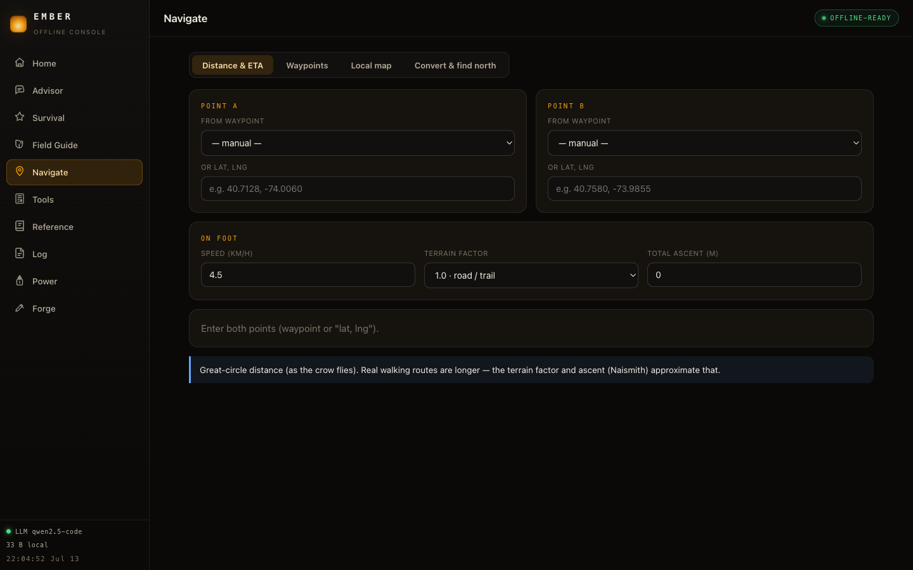
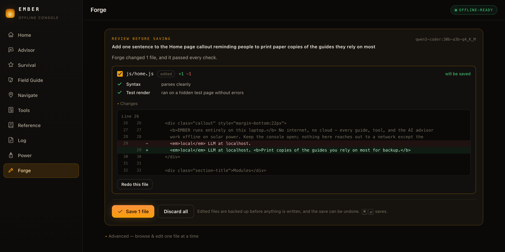
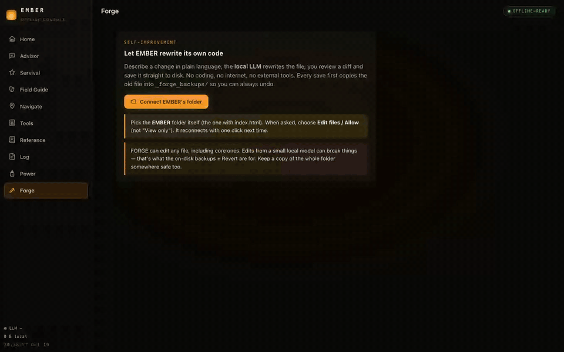

EMBER is a survival console for a laptop with no internet. It runs entirely on one machine: no cell service, no cloud, no CDN, no telemetry. Load it once and it caches itself; after that it opens with the network gone. The only thing it ever talks to is a local language model at `localhost`.

I built it around one scenario: the grid is down, the laptop on the table is running off a solar panel, and it's the last computer that matters. That decided most of the design. System fonts only, a warm dark theme that's easy on an OLED screen and on eyes at night, zero external requests, and a knowledge base kept in plain JavaScript files you can read yourself.

<p align="center">
  
</p>

## The modules

| Module | What it does |
|---|---|
| **Advisor** | Chat with a local model through Ollama. Good for repairs, planning and arithmetic. It can be confidently wrong, so the screen says not to rely on it for medication or for deciding what is safe to eat. |
| **Survival** | 38 searchable guides: water, fire, shelter, first aid, food, navigation, signaling, weather, repair, sanitation and more. Each prints to PDF while you still have paper. |
| **Field Guide** | Hand-written, feature-based entries for edible and toxic plants and mushrooms, with look-alike warnings, plus a common-medication reference. No model writes this content. |
| **Navigate** | Distance, bearing and walking time between saved waypoints (Naismith's rule for climbs), coordinate conversion, ways to find north, and a local map mode: load a photo or scan of a paper map, mark two known points, then tap anywhere to read coordinates and measure. |
| **Tools** | Scientific calculator, unit converter and field constants. |
| **Reference** | Morse code with an audible trainer, the NATO alphabet, knots and emergency radio frequencies. |
| **Log** | Journal, supply inventory and a ration planner that says how many days of water and food are left. |
| **Power** | Solar and battery budgeting: whether a panel can sustain your draw, and how to stretch a charge. |
| **Forge** | EMBER editing its own code from a plain-language request. See below. |

<table>
<tr>
<td width="50%"></td>
<td width="50%"></td>
</tr>
<tr>
<td><em>Survival. The things that kill you first come first.</em></td>
<td><em>Field Guide. Edible or toxic, with look-alike warnings.</em></td>
</tr>
<tr>
<td width="50%"></td>
<td width="50%"></td>
</tr>
<tr>
<td><em>Navigate. Walking times corrected for climbing, with no map tiles.</em></td>
<td><em>Forge. Every check in plain words, then the diff, then you decide.</em></td>
</tr>
</table>

## Quickstart

**Easiest (macOS):** double-click **`serve.command`**. It serves the folder at `http://localhost:8787` and opens your browser. Leave the little terminal window open.

**Any OS:**

```bash
git clone https://github.com/AllStreets/ember.git
cd ember
python3 -m http.server 8787
# open http://localhost:8787
```

Serving over `localhost` (rather than opening `index.html` as a `file://`) matters for two reasons: the service worker that makes EMBER cache itself, and the connection to the local LLM.

After the first load it caches itself, and you can open it again with no network at all.

---

## The local AI

Do this once while you still have internet. After that the model runs offline, because its weights live on your disk.

The Advisor talks only to a model on this machine:

1. Install [Ollama](https://ollama.com), a small app that runs language models locally.
2. Pull a capable-but-small model (pick one):
   ```bash
   ollama pull llama3.2         # light, fast, good default
   ollama pull qwen2.5:7b       # stronger reasoning
   ollama pull gemma2:9b        # larger, if you have the RAM
   ```
3. Ollama serves at `http://localhost:11434` automatically. Reload EMBER and the model status in the sidebar turns green.

If Ollama is running but EMBER says offline, allow the browser origin by starting Ollama with `OLLAMA_ORIGINS=*` (or add `http://localhost:8787`). You can also change the host from the Advisor's setup panel.

---

## Forge

EMBER can edit its own source code from a plain-language request, using the same local model. You describe a fix or a feature, the model proposes a change to one file, EMBER runs its validation checks on the result, and you review the diff before anything is written. Saving goes straight to disk through the File System Access API (Chrome, Edge or Brave, after connecting the folder once).

The review shows, for each file, what every check found in plain words (syntax, the app shell for `index.html`, and a test render on a hidden page), then a line diff with old and new line numbers. A file that fails a check can't be ticked. Every save copies the old file into `_forge_backups/` first, and the status bar that confirms the save has an Undo button. Every question Forge asks, from "save anyway?" to "revert these files?", is one accessible dialog, not a browser popup. `forge-selftest.mjs` exercises the pipeline end to end.

<p align="center"></p>
<p align="center"><em>Real time, with a real local model (qwen3-coder 30B). Nothing is sped up.</em></p>

The review step earned its place. Early on, Forge produced a tide calculator that returned hard-coded times behind a fake loading delay. It passed every automatic check, because it was valid code that returned plausible output. I caught it reading the diff and removed it ([63127c6](https://github.com/AllStreets/ember/commit/63127c6)). A change that looks right is not the same as a change that is right, which is why a person approves every write.

---

## Under the hood

```
EMBER/
├─ index.html            the shell: one page, ten modules
├─ sw.js                 service worker: cache-everything, run with the network dead
├─ js/                   one module per file: advisor, survival, navigate, forge and the rest
│  ├─ llm.js             the only network code in the app: localhost Ollama client
│  └─ store.js           localStorage persistence, 17 lines
├─ data/                 the knowledge base: guides, field guide, reference tables
│  └─ kb.js              plain JavaScript you can read and extend by hand
├─ css/app.css           the theme: system fonts, no external assets
├─ serve.command         double-click launcher (macOS)
└─ forge-selftest.mjs    self-test harness for the Forge pipeline
```

- **No build step, no framework, no package.json.** Vanilla ES modules; the source you read is the code that runs.
- **Zero external requests.** No CDN fonts, scripts or images. Search the source and the only host it contacts is `localhost`.
- **Light on power.** A warm dark theme, the system font stack, and very little animation.
- **PWA offline shell.** The service worker caches every file on first load; updates are picked up when you're back online.

---

## Your data

Everything you enter (chats, waypoints, journal, supplies, settings) is stored in this browser's local storage on this device. **Nothing leaves the laptop.** Clearing the browser data wipes it, so keep paper backups of anything critical.

---

## Not a substitute for training

These guides are concise reference, not professional medical, legal or tactical advice. That goes double for anything the Advisor says. Where trained help exists, use it. Practice the skills before you need them.

---

MIT © 2026 [Connor Evans](https://github.com/AllStreets). See [LICENSE](LICENSE).
